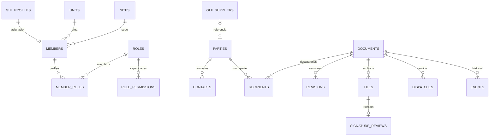

# Correspondencia y archivo · versión de integración 2026-11-13

Implementación local comprobada; las migraciones 024/025, el despacho Gmail y las asignaciones reales todavía no están activados. No sustituye la administración central interaplicaciones, que continúa pendiente. El directorio documental no crea cuentas ni recibe respuestas KYC.

## Recorrido operativo

1. Administración asigna dirección/área, sede, cargo, iniciales y perfiles a una cuenta GLF existente. El área no concede permisos. El menú es visible; cada acción y cada RPC comprueban permisos y MFA.
2. Redacción selecciona una institución o vincula un proveedor existente. Puede registrar otra contraparte desde el oficio. Para persona natural se solicitan nombres; para institución, razón social y contacto/representante. No se exige RUC ni información bancaria.
3. El oficio empieza como borrador, con asunto, fecha, lugar, contenido, destinatarios y copias. El autor selecciona un firmante habilitado, que puede ser otra persona. Puede adjuntar Word y recuperar su texto para revisarlo dentro de la plantilla.
4. El firmante devuelve con observaciones o aprueba. Aprobar bloquea la versión y asigna una secuencia anual común, en una transacción. No se consume número al crear borrador o descargar. La segunda solicitud con una versión antigua se rechaza.
5. Se descarga el PDF, se firma con una herramienta externa, se incorpora y se registra la comprobación humana de firmante, integridad y contenido. Registrar esa revisión no equivale a verificar criptográficamente la firma desde el servidor.
6. Despacho prepara destinatarios, copias, asunto y mensaje. Si Gmail está configurado, una confirmación envía el PDF firmado y los anexos. Sin conexión, se copia el mensaje, se envía manualmente y se incorpora una constancia antes de marcar enviado. Descargar nunca marca enviado.
7. Recepción registra los oficios entrantes, incorpora el original PDF, asigna responsable/plazo y enlaza una respuesta de salida. Archivo registra el cierre y su motivo.

La numeración presentada es `C-GLF-0001-AÑO`; antes de emitir documentos reales hay que ratificar formato y conciliar el último consecutivo institucional. Debajo de la firma aparece `ÁREA-SEDE-INICIALES`, sin “Elaborado por”. SX corresponde a Santa Cruz y SC a San Cristóbal. La plantilla A4 incluye logotipo superior derecho y página X de Y inferior derecha.

## Modelo relacional y reutilización

Auditoría reproducible con `npm run audit:schema` y `node scripts/audit-schema.mjs --baseline`. Reconstruye PostgreSQL desde las migraciones; **no es un inventario del servidor de producción**. Excluye esquemas de infraestructura Auth/Storage.

| Medida | Antes de este módulo | Con Correspondencia |
|---|---:|---:|
| Tablas | 17 | 34 |
| Columnas repartidas entre tablas | 179 | 289 |
| Máximo de columnas de una tabla | 40 | 40 |
| Claves foráneas | 25 | 57 |

No se encontró una tabla de 560 columnas. Contar columnas en toda la base no determina su normalización. Se conserva el esquema KYC existente; no se reinterpretan ni migran sus respuestas por esta incorporación.

Correspondencia añade 17 tablas pequeñas, con 110 columnas en total:

| Grupo | Tablas | Uso |
|---|---|---|
| Organización y permisos | units, sites, roles, role_permissions, members, member_roles | Una asignación referencia la cuenta GLF existente; relaciones muchos-a-muchos para capacidades. |
| Contrapartes | parties, contacts | Si hay proveedor, se conserva solo su identificador. Sus datos comerciales se resuelven desde la ficha original. |
| Oficios | documents, recipients, access, counters | Documento, destinatarios/copia/remitente, accesos restringidos y consecutivo anual separados. |
| Evidencia | revisions, files, signature_reviews, dispatches, events | Versión aprobada, archivos, revisión de firma, envío y trazabilidad. |



Las copias JSON de versiones aprobadas y el sobre de correo son **evidencia histórica deliberadamente congelada**, no un segundo catálogo editable. Sin esa copia, cambiar el representante de una institución alteraría un oficio ya emitido. Los archivos binarios están en Storage privado; PostgreSQL guarda referencias/metadatos.

## Autorización e integridad

- Se reutilizan identidad compartida y `glf_profiles`; no se incorporan contraseñas ni cuentas paralelas. `manage_users` controla Administración. No se conceden permisos reales por nombre, área ni rol KYC.
- Permisos explícitos: redactar, gestionar contactos, recibir, asignar, firmar, despachar y archivar. Recepción no se concede a todos.
- Consulta ordinaria para internos activos con MFA; restringida para autor, firmante, responsable o acceso explícito. Ser administrador de perfiles no abre automáticamente un documento restringido.
- Esquema privado, RLS activado, acceso por RPC con `search_path` fijo; el navegador no puede editar tablas ni asignarse privilegios. Worker de correo reservado a `service_role`.
- Archivo privado: boleto de carga asociado a usuario/documento/estado, límite 20 MB, sin sobrescritura ni borrado desde el cliente. Confirmación comprueba existencia y tamaño. La revisión documental sigue siendo humana; no hay antivirus ni análisis criptográfico implementado.
- Guardados con versión esperada: se rechazan ediciones desactualizadas. Si el perfil de origen cambia antes de aprobar, el firmante debe devolver y el autor revisar/guardar nuevamente. La versión aprobada no cambia por modificaciones posteriores del directorio.
- Contador anual con bloqueo transaccional y unicidad `(year, sequence)`. No se renumeran registros anteriores. Anulación/reemisión formal y conciliación inicial de consecutivos requieren completar su flujo antes de uso oficial.
- Correo con constancia: Gmail aceptado no significa entregado/leído. Un resultado incierto bloquea el reenvío automático; su conciliación administrativa todavía debe realizarse con el buzón y soporte técnico. No hay lectura automática del buzón ni seguimiento de rebotes.

## Rendimiento e interfaz

ES/EN, estilos, botones e iconos compartidos con la aplicación. Correspondencia, PDF, Word y Administración se importan solo al abrirlos. Listados de 50 registros; búsquedas de contraparte desde el editor, índices de bandeja, autor, responsable, acceso y archivos. Se validan fechas en zona Galápagos, longitudes, tipos, destinatarios, permisos y estados en cliente y servidor. Los campos observados reciben foco y resaltado. La edición avisa antes de abandonar cambios sin guardar.

No se añadió otra biblioteca: se reutilizan jsPDF y JSZip. El Word original se conserva y su texto se importa para revisión; no se promete reproducir exactamente estilos, tablas o imágenes del Word. No hay aplicación Windows separada, edición offline oficial ni sincronización Drive en esta entrega.

## Activación controlada

1. Verificar repositorio `soulkernel/Prototipo.Proveedores.KYC`, carpeta `aplicacion-proveedores-kyc`, rama de integración y esquema real. No publicar la carpeta documental superior.
2. Probar en entorno separado con la identidad compartida. Aplicar 024 y 025 una sola vez, después de 001–023. Son aditivas: no borran proveedores, expedientes o identidades.
3. Comprobar acceso real MFA y Storage con dos cuentas internas y una sin permisos. Las pruebas locales usan PostgreSQL embebido y una interfaz de demostración, no demuestran por sí solas la conexión OIDC/Storage desplegada.
4. Asignar miembros/perfiles explícitamente desde Administración. No ejecutar listas nominales por inferencia. Confirmar formato y consecutivo antes de documentos oficiales.
5. Compilar/publicar la aplicación en Vercel con sus variables actuales, sin cambiarla a demostración. No es necesario desplegar Gmail para probar recepción, preparación, firma externa y constancia manual.
6. Cuando Workspace autorice el buzón, desplegar la función `correspondence-send` con `--no-verify-jwt` **solo para esta función**. La comprobación de autorización OIDC/MFA está en su RPC autenticada; no suprimirla. No deshabilitar controles de otras funciones.

Secretos exclusivamente del servidor de la función:

| Variable | Contenido |
|---|---|
| GLF_ALLOWED_ORIGIN | Origen HTTPS exacto de la aplicación |
| GLF_GMAIL_CLIENT_ID / GLF_GMAIL_CLIENT_SECRET | Cliente OAuth institucional autorizado |
| GLF_GMAIL_REFRESH_TOKEN | Autorización del buzón con alcance `gmail.send` |
| GLF_GMAIL_FROM | Cuenta o alias de envío ya autorizado en Gmail |
| GLF_GMAIL_REPLY_TO | Opcional, destino de respuestas |

Supabase aporta URL, anon y service role al entorno de funciones. La clave de servicio nunca entra en Vercel frontend, código público o manual de usuarios. El buzón propuesto depende de la respuesta del administrador; no se verificó en esta entrega. Límite de anexos para correo: 18 MB antes de codificación. No se enviaron correos de prueba.

## Verificación reproducible

```text
npm test
npm run test:database
npm run test:kyc
npm run test:records
npm run build:demo
npm run qa:records
npm run audit:schema
```

Pruebas cubren aislamiento, MFA, permisos, concurrencia optimista, numeración, cambio de origen, archivos, revisión y despacho. QA Edge usa datos ficticios y no simula una firma real: directorio, Word, PDF, carga, envío manual, Administración, inglés y móvil. Capturas/PDF de prueba se guardan en `test-results/records` local, fuera de la publicación. La comprobación de sintaxis TypeScript de la función no equivale a desplegarla en Deno ni a probar OAuth real.
