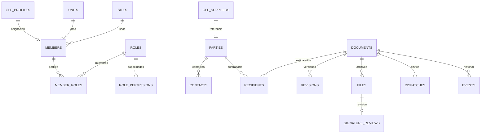

# Correspondencia y archivo · versión de integración 2026-11-13

Módulo publicado en Vercel el 13/11/2026, con las migraciones 024/025/026 aplicadas en Supabase y recorrido autenticado comprobado con datos sintéticos. El despacho Gmail continúa pendiente de configuración. No sustituye la administración central interaplicaciones, que continúa pendiente. El directorio documental no crea cuentas ni recibe respuestas KYC.

## Recorrido operativo

1. Administración asigna dirección/área, sede, cargo, iniciales y perfiles a una cuenta GLF existente. El área no concede permisos. El menú es visible; cada acción y cada RPC comprueban permisos y MFA.
2. Redacción selecciona una institución o vincula un proveedor existente. Puede registrar otra contraparte desde el oficio. Para persona natural se solicitan nombres; para institución, razón social y contacto/representante. No se exige RUC ni información bancaria.
3. El oficio empieza como borrador, con asunto, fecha, lugar, contenido, destinatarios y copias. El autor selecciona un firmante habilitado, que puede ser otra persona. Puede adjuntar Word y recuperar su texto para revisarlo dentro de la plantilla.
4. El firmante devuelve con observaciones o aprueba. Aprobar bloquea la versión y asigna una secuencia anual común, en una transacción. No se consume número al crear borrador o descargar. La segunda solicitud con una versión antigua se rechaza.
5. Se descarga el PDF, se firma con una herramienta externa, se incorpora y se registra la comprobación humana de firmante, integridad y contenido. Registrar esa revisión no equivale a verificar criptográficamente la firma desde el servidor.
6. Despacho prepara destinatarios, copias, asunto y mensaje. Si Gmail está configurado, una confirmación envía el PDF firmado y los anexos. Sin conexión, se copia el mensaje, se envía manualmente y se incorpora una constancia antes de marcar enviado. Descargar nunca marca enviado.
7. Recepción registra los oficios entrantes, incorpora el original PDF, asigna responsable/plazo y enlaza una respuesta de salida. Archivo registra el cierre y su motivo.

Numeración acordada: entrada `GLF-EXT-AÑO-00001`; salida `GLF-AÑO-00001`. Son secuencias anuales independientes, comunes para todas las áreas y sedes. Los números anteriores `C-GLF-0001-AÑO` se conservan. Antes de documentos reales se debe conciliar el consecutivo institucional. Debajo de la firma aparece `ÁREA-SEDE-INICIALES`, sin “Elaborado por”. SX corresponde a Santa Cruz y SC a San Cristóbal. La plantilla A4 incluye logotipo superior derecho y página X de Y inferior derecha.

## Modelo relacional y reutilización

Auditoría reproducible con `npm run audit:schema` y `node scripts/audit-schema.mjs --baseline`. Reconstruye PostgreSQL desde las migraciones; **no es un inventario del servidor de producción**. Excluye esquemas de infraestructura Auth/Storage.

| Medida | Antes de este módulo | Con Correspondencia |
|---|---:|---:|
| Tablas | 17 | 34 |
| Columnas repartidas entre tablas | 179 | 289 |
| Máximo de columnas de una tabla | 40 | 40 |
| Claves foráneas | 25 | 57 |

No se encontró una tabla de 560 columnas. Contar columnas en toda la base no determina su normalización. Se conserva el esquema KYC existente; no se reinterpretan ni migran sus respuestas por esta incorporación.

Correspondencia añade 17 tablas pequeñas, con 110 columnas en total:

| Grupo | Tablas | Uso |
|---|---|---|
| Organización y permisos | units, sites, roles, role_permissions, members, member_roles | Una asignación referencia la cuenta GLF existente; relaciones muchos-a-muchos para capacidades. |
| Contrapartes | parties, contacts | Si hay proveedor, se conserva solo su identificador. Sus datos comerciales se resuelven desde la ficha original. |
| Oficios | documents, recipients, access, counters | Documento, destinatarios/copia/remitente, accesos restringidos y consecutivo anual separados. |
| Evidencia | revisions, files, signature_reviews, dispatches, events | Versión aprobada, archivos, revisión de firma, envío y trazabilidad. |



Las copias JSON de versiones aprobadas y el sobre de correo son **evidencia histórica deliberadamente congelada**, no un segundo catálogo editable. Sin esa copia, cambiar el representante de una institución alteraría un oficio ya emitido. Los archivos binarios están en Storage privado; PostgreSQL guarda referencias/metadatos.

## Autorización e integridad

- Se reutilizan identidad compartida y `glf_profiles`; no se incorporan contraseñas ni cuentas paralelas. `manage_users` controla Administración. No se conceden permisos reales por nombre, área ni rol KYC.
- Permisos explícitos: redactar, gestionar contactos, recibir, asignar, firmar, despachar y archivar. Recepción no se concede a todos.
- Consulta ordinaria para internos activos con MFA; restringida para autor, firmante, responsable o acceso explícito. Ser administrador de perfiles no abre automáticamente un documento restringido.
- Esquema privado, RLS activado, acceso por RPC con `search_path` fijo; el navegador no puede editar tablas ni asignarse privilegios. Worker de correo reservado a `service_role`.
- Archivo privado: boleto de carga asociado a usuario/documento/estado, límite 20 MB, sin sobrescritura ni borrado desde el cliente. Confirmación comprueba existencia y tamaño. La revisión documental sigue siendo humana; no hay antivirus ni análisis criptográfico implementado.
- Guardados con versión esperada: se rechazan ediciones desactualizadas. Si el perfil de origen cambia antes de aprobar, el firmante debe devolver y el autor revisar/guardar nuevamente. La versión aprobada no cambia por modificaciones posteriores del directorio.
- Contador anual con bloqueo transaccional y unicidad `(year, sequence)`. No se renumeran registros anteriores. Anulación/reemisión formal y conciliación inicial de consecutivos requieren completar su flujo antes de uso oficial.
- Correo con constancia: Gmail aceptado no significa entregado/leído. Un resultado incierto bloquea el reenvío automático; su conciliación administrativa todavía debe realizarse con el buzón y soporte técnico. No hay lectura automática del buzón ni seguimiento de rebotes.

## Rendimiento e interfaz

ES/EN, estilos, botones e iconos compartidos con la aplicación. Correspondencia, PDF, Word y Administración se importan solo al abrirlos. Listados de 50 registros; búsquedas de contraparte desde el editor, índices de bandeja, autor, responsable, acceso y archivos. Se validan fechas en zona Galápagos, longitudes, tipos, destinatarios, permisos y estados en cliente y servidor. Los campos observados reciben foco y resaltado. La edición avisa antes de abandonar cambios sin guardar.

Se reutilizan jsPDF y JSZip. La actualización de recepción incorpora pdf-lib con carga diferida para comprobar los PDF sin reescribirlos. El Word original se conserva y su texto se importa para revisión; no se promete reproducir exactamente estilos, tablas o imágenes del Word. No hay aplicación Windows separada, edición offline oficial ni sincronización Drive en esta entrega.

## Activación controlada

1. Verificar repositorio `soulkernel/Prototipo.Proveedores.KYC`, carpeta `aplicacion-proveedores-kyc`, rama de integración y esquema real. No publicar la carpeta documental superior.
2. Para otra instalación, probar en entorno separado con la identidad compartida. Aplicar 024, 025 y 026 una sola vez, después de 001–023. Son aditivas: no borran proveedores, expedientes o identidades. La 026 impide crear contactos vacíos; la interfaz también omite opciones vacías históricas, sin borrar registros.
3. Comprobar acceso real MFA y Storage con dos cuentas internas y una sin permisos. Las pruebas locales usan PostgreSQL embebido y una interfaz de demostración, no demuestran por sí solas la conexión OIDC/Storage desplegada.
4. Asignar miembros/perfiles explícitamente desde Administración. No ejecutar listas nominales por inferencia. Confirmar formato y consecutivo antes de documentos oficiales.
5. Compilar/publicar la aplicación en Vercel con sus variables actuales, sin cambiarla a demostración. No es necesario desplegar Gmail para probar recepción, preparación, firma externa y constancia manual.
6. Cuando Workspace autorice el buzón, desplegar la función `correspondence-send` con `--no-verify-jwt` **solo para esta función**. La comprobación de autorización OIDC/MFA está en su RPC autenticada; no suprimirla. No deshabilitar controles de otras funciones.

Secretos exclusivamente del servidor de la función:

| Variable | Contenido |
|---|---|
| GLF_ALLOWED_ORIGIN | Origen HTTPS exacto de la aplicación |
| GLF_GMAIL_CLIENT_ID / GLF_GMAIL_CLIENT_SECRET | Cliente OAuth institucional autorizado |
| GLF_GMAIL_REFRESH_TOKEN | Autorización del buzón con alcance `gmail.send` |
| GLF_GMAIL_FROM | Cuenta o alias de envío ya autorizado en Gmail |
| GLF_GMAIL_REPLY_TO | Opcional, destino de respuestas |

Supabase aporta URL, anon y service role al entorno de funciones. La clave de servicio nunca entra en Vercel frontend, código público o manual de usuarios. El buzón propuesto depende de la respuesta del administrador; no se verificó en esta entrega. Límite de anexos para correo: 18 MB antes de codificación. No se enviaron correos de prueba.

## Verificación reproducible

```text
npm test
npm run test:database
npm run test:kyc
npm run test:records
npm run build:demo
npm run qa:records
npm run audit:schema
```

Pruebas cubren aislamiento, MFA, permisos, concurrencia optimista, numeración, cambio de origen, archivos, revisión y despacho. QA Edge usa datos ficticios y no simula una firma real: directorio, Word, PDF, carga, envío manual, Administración, inglés y móvil. Capturas/PDF de prueba se guardan en `test-results/records` local, fuera de la publicación. La comprobación de sintaxis TypeScript de la función no equivale a desplegarla en Deno ni a probar OAuth real.

### Comprobación del despliegue — 13/11/2026

La PR #2 se integró en main (`cef5b83`) y Vercel confirmó Production Ready. Las migraciones se ejecutaron mediante SQL Editor, con resultado satisfactorio, no mediante el historial automático de migraciones de la CLI. Consulta posterior: 17 tablas nuevas, todas con RLS, 110 columnas, bucket privado, sin ejecución anónima del RPC ni acceso del cliente al worker de correo. Se conservaron los 22 proveedores y 11 expedientes KYC existentes.

Con la sesión interna y MFA existentes se verificaron: asignación organizativa del administrador de prueba; vínculo con proveedor sin duplicarlo; institución independiente; oficio de salida, archivo, aprobación, numeración y descarga PDF; recepción de oficio restringido, carga PDF, asignación y plazo. Los registros son sintéticos. No se firmaron documentos reales ni se enviaron correos. La comprobación con otros perfiles corresponde por ahora a las pruebas SQL locales, no a sesiones reales de otros usuarios.

Las asignaciones de personal deben configurarse sobre cuentas verificadas. No se concedieron permisos nominales a otros miembros del GLF. La función de correo está preparada en código, pero no desplegada ni autorizada en Workspace. Drive, administración central entre aplicaciones y numeración oficial siguen pendientes de sus respectivas integraciones o definiciones.

## Bandejas y numeración acordadas — 13/11/2026

Migración 027, después de 026. Dos bandejas: Oficios recibidos y Oficios de salida. Solo la segunda ofrece Crear oficio y firma/aprobación; la primera registra remitente, origen, recepción, canal, archivo y ubicación física opcional. Cada bandeja mantiene sus filtros. La búsqueda y paginación se aplican en el servidor por dirección, número GLF/de origen, asunto, contraparte, fechas, responsable/autor, firmante o plazo. La relación recibido-respuesta es navegable; crear una respuesta no marca el ingreso como atendido ni enviado.

Recepción: datos básicos → comprobación del PDF → guardado técnico incompleto → carga privada y confirmación → Registrar recepción. Solo la última operación asigna número y estado Recibido. Una falla de carga no consume consecutivo; el registro incompleto puede retomarse. El servidor exige un PDF confirmado para numerar. Las cargas conservan originales y nuevas versiones, con motivo obligatorio al incorporar otro PDF principal. Anexos PDF separados después del registro. Máximo 20 MiB (20 MB en interfaz), en cliente, tickets y Storage; vista previa local, páginas y tamaño visibles. Comprobación estructural y rechazo de cifrado se realizan en navegador mediante pdf-lib; no equivalen a antivirus, verificación criptográfica ni garantía de legibilidad. El servidor comprueba permiso, formato declarado, tamaño, objeto y estado; no analiza el contenido binario del PDF.

Número de origen e interno son campos distintos. La migración conserva números ya emitidos y contador de salida; nuevos números usan GLF-AÑO-00001 y GLF-EXT-AÑO-00001. Los ingresos históricos sin número interno se numeran explícitamente desde su detalle cuando cuentan con PDF; no se inventan registros ni se renumera automáticamente. Año del registro/aprobación en zona Galápagos. Idempotencia de completar recepción y restricciones únicas impiden consumir dos números en un reintento.

Pruebas: 97 automatizadas (17 generales, 21 datos, 44 KYC, 15 documentales/PDF/migración); recorrido local Edge con recibido físico, PDF obligatorio, vista previa, numeración, filtros separados, respuesta vinculada, ES/EN y móvil. Migración probada sobre datos anteriores, preservando número y versión aprobada. Aplicar 027 antes de publicar esta interfaz; no cambia roles, identidad ni permisos.

Referencia técnica del lector PDF: https://pdf-lib.js.org/docs/api/classes/pdfdocument#load

Activación verificada: migración 027 aplicada en Supabase (Success. No rows returned), versión b653eac7e9ca3114d520be770daa35d7f996a2e8 publicada en main y Vercel satisfactorio. Lectura posterior confirma 22 proveedores, 11 expedientes KYC, RLS activo y bucket privado; número antiguo C-GLF-0001-2026 conservado. La sesión interna real registró un PDF sintético con GLF-EXT-2026-00001 y preparó su respuesta vinculada. No se firmaron ni enviaron documentos. Los identificadores de los registros de prueba y las comprobaciones posteriores se guardan en el contexto reservado.


## Borradores de salida — 13/11/2026

Acceso Borradores con conteo autorizado, asunto, autor y última modificación. Guardar borrador admite asunto con fecha precargada, sin destinatario, contenido ni firmante; estos se validan al remitir a firma, también en servidor. No asigna número ni envía correo. Continuar edición retoma el registro persistido con control de versión. Guardar y salir / Salir sin guardar / Seguir editando en navegación interna, incluidos cambios de módulo y cierre de sesión; al cerrar o recargar el navegador se mantiene el aviso nativo de cambios pendientes (no puede guardar desde ese diálogo). Guardado explícito con fecha y hora, sin autoguardado. Permisos y clasificación existentes conservados.

Migración 028 reemplaza solo la RPC, sin nuevas tablas, columnas o privilegios; exige destinatario para pasar a revisión y conserva la exigencia de remitente para entradas. Conteo de borradores limitado a documentos legibles. Pruebas: 16 documentales y 17 generales; QA Edge de borradores y recorrido completo de Correspondencia, incluidos ES/EN y móvil, satisfactorios. Activación y verificación publicada se registrarán en el contexto compartido tras aplicar la migración.


## Fecha, firmante, anexos y sede — 13/11/2026

Migración 029: fecha y lugar de oficios de salida determinados por el servidor. Al guardar se usa el día en Pacific/Galapagos y la sede activa del autor; valores manuales enviados por clientes se sustituyen. La aprobación fija la fecha del día antes de congelar la revisión y numerar. Hora de guardado/aprobación registrada en eventos existentes. No se alteran oficios emitidos ni fechas de origen de entradas. Sin nuevas columnas o privilegios.

Redacción sin fecha/lugar editables. Persona que suscribe presenta al usuario por defecto cuando tiene permiso de firma, con Cambiar persona que suscribe; quien solo redacta puede asignar un firmante autorizado, sin concederse permisos. Asignaciones administrativas usa Sede de trabajo, filtro de usuarios por sede y tabla con área, cargo y siglas. No crea cuentas por separado ni concede nuevas facultades. Sede e iniciales del autor determinan el origen incluso si firma otra persona.

Anexos en redacción: selección múltiple PDF, máximo 20 MiB por archivo, pendientes hasta Guardar borrador/Guardar y salir; puede quitar pendientes. Se valida estructura y nombre duplicado antes de encolar. Se cargan en Storage privado y se vinculan al documento con versiones/control de concurrencia. Los nombres se incorporan automáticamente en una sección Anexos después del contenido y antes de la firma, en vista previa y PDF. El listado aprobado queda congelado; los documentos aprobados no aceptan nuevos anexos. No se fusionan ni reescriben archivos firmados.

Pruebas: 17 documentales automatizadas; QA Edge de fecha, firmante por defecto/cambio/usuario sin permiso, dos anexos, persistencia, PDF, nombres duplicados, ES/EN, móvil y filtro de sedes; borradores y recorrido documental completo. Extracción del PDF confirma ambos nombres una sola vez antes de Atentamente. Las pruebas detectaron y corrigieron un aviso de cambios tras archivo rechazado y filas ocultas del filtro en móvil. Publicación/activación se registran en contexto compartido al verificarse.
