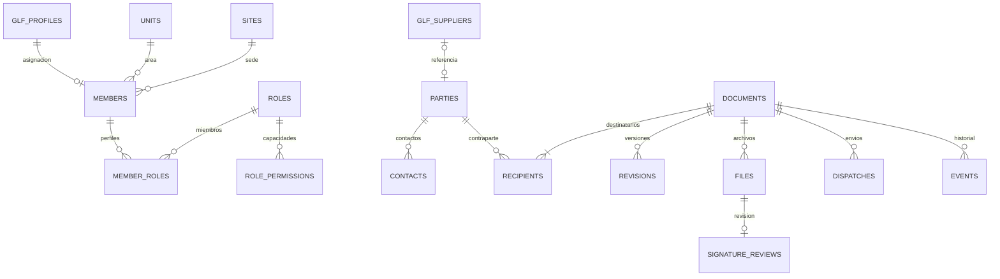

# Correspondencia y archivo · versión de integración 2026-11-13

Módulo publicado en Vercel el 13/11/2026, con las migraciones 024/025/026 aplicadas en Supabase y recorrido autenticado comprobado con datos sintéticos. El despacho Gmail continúa pendiente de configuración. No sustituye la administración central interaplicaciones, que continúa pendiente. El directorio documental no crea cuentas ni recibe respuestas KYC.

## Recorrido operativo

1. Administración asigna dirección/área, sede, cargo, iniciales y perfiles a una cuenta GLF existente. El área no concede permisos. El menú es visible; cada acción y cada RPC comprueban permisos y MFA.
2. Redacción selecciona una institución o vincula un proveedor existente. Puede registrar otra contraparte desde el oficio. Para persona natural se solicitan nombres; para institución, razón social y contacto/representante. No se exige RUC ni información bancaria.
3. El oficio empieza como borrador, con asunto, fecha, lugar, contenido, destinatarios y copias. El autor selecciona un firmante habilitado, que puede ser otra persona. Puede adjuntar Word y recuperar su texto para revisarlo dentro de la plantilla.
4. El firmante devuelve con observaciones o aprueba. Aprobar bloquea la versión y asigna una secuencia anual común, en una transacción. No se consume número al crear borrador o descargar. La segunda solicitud con una versión antigua se rechaza.
5. Se descarga el PDF, se firma con una herramienta externa, se incorpora y se registra la comprobación humana de firmante, integridad y contenido. Registrar esa revisión no equivale a verificar criptográficamente la firma desde el servidor.
6. Despacho prepara destinatarios, copias, asunto y mensaje. Si Gmail está configurado, una confirmación envía el PDF firmado y los anexos. Sin conexión, se copia el mensaje, se envía manualmente y se incorpora una constancia antes de marcar enviado. Descargar nunca marca enviado.
7. Recepción registra los oficios entrantes, incorpora el original PDF, asigna responsable/plazo y enlaza una respuesta de salida. Archivo registra el cierre y su motivo.

Numeración acordada: entrada `GLF-EXT-AÑO-00001`; salida `GLF-AÑO-00001`. Son secuencias anuales independientes, comunes para todas las áreas y sedes. Los números anteriores `C-GLF-0001-AÑO` se conservan. Antes de documentos reales se debe conciliar el consecutivo institucional. Debajo de la firma aparece `ÁREA-SEDE-INICIALES`, sin “Elaborado por”. SX corresponde a Santa Cruz y SC a San Cristóbal. La plantilla A4 incluye logotipo superior derecho y página X de Y inferior derecha.

## Modelo relacional y reutilización

Auditoría reproducible con `npm run audit:schema` y `node scripts/audit-schema.mjs --baseline`. Reconstruye PostgreSQL desde las migraciones; **no es un inventario del servidor de producción**. Excluye esquemas de infraestructura Auth/Storage.

| Medida | Antes de este módulo | Con Correspondencia |
|---|---:|---:|
| Tablas | 17 | 34 |
| Columnas repartidas entre tablas | 179 | 289 |
| Máximo de columnas de una tabla | 40 | 40 |
| Claves foráneas | 25 | 57 |

No se encontró una tabla de 560 columnas. Contar columnas en toda la base no determina su normalización. Se conserva el esquema KYC existente; no se reinterpretan ni migran sus respuestas por esta incorporación.

Correspondencia añade 17 tablas pequeñas, con 110 columnas en total:

| Grupo | Tablas | Uso |
|---|---|---|
| Organización y permisos | units, sites, roles, role_permissions, members, member_roles | Una asignación referencia la cuenta GLF existente; relaciones muchos-a-muchos para capacidades. |
| Contrapartes | parties, contacts | Si hay proveedor, se conserva solo su identificador. Sus datos comerciales se resuelven desde la ficha original. |
| Oficios | documents, recipients, access, counters | Documento, destinatarios/copia/remitente, accesos restringidos y consecutivo anual separados. |
| Evidencia | revisions, files, signature_reviews, dispatches, events | Versión aprobada, archivos, revisión de firma, envío y trazabilidad. |



Las copias JSON de versiones aprobadas y el sobre de correo son **evidencia histórica deliberadamente congelada**, no un segundo catálogo editable. Sin esa copia, cambiar el representante de una institución alteraría un oficio ya emitido. Los archivos binarios están en Storage privado; PostgreSQL guarda referencias/metadatos.

## Autorización e integridad

- Se reutilizan identidad compartida y `glf_profiles`; no se incorporan contraseñas ni cuentas paralelas. `manage_users` controla Administración. No se conceden permisos reales por nombre, área ni rol KYC.
- Permisos explícitos: redactar, gestionar contactos, recibir, asignar, firmar, despachar y archivar. Recepción no se concede a todos.
- Consulta ordinaria para internos activos con MFA; restringida para autor, firmante, responsable o acceso explícito. Ser administrador de perfiles no abre automáticamente un documento restringido.
- Esquema privado, RLS activado, acceso por RPC con `search_path` fijo; el navegador no puede editar tablas ni asignarse privilegios. Worker de correo reservado a `service_role`.
- Archivo privado: boleto de carga asociado a usuario/documento/estado, límite 20 MB, sin sobrescritura ni borrado desde el cliente. Confirmación comprueba existencia y tamaño. La revisión documental sigue siendo humana; no hay antivirus ni análisis criptográfico implementado.
- Guardados con versión esperada: se rechazan ediciones desactualizadas. Si el perfil de origen cambia antes de aprobar, el firmante debe devolver y el autor revisar/guardar nuevamente. La versión aprobada no cambia por modificaciones posteriores del directorio.
- Contador anual con bloqueo transaccional y unicidad `(year, sequence)`. No se renumeran registros anteriores. Anulación/reemisión formal y conciliación inicial de consecutivos requieren completar su flujo antes de uso oficial.
- Correo con constancia: Gmail aceptado no significa entregado/leído. Un resultado incierto bloquea el reenvío automático; su conciliación administrativa todavía debe realizarse con el buzón y soporte técnico. No hay lectura automática del buzón ni seguimiento de rebotes.

## Rendimiento e interfaz

ES/EN, estilos, botones e iconos compartidos con la aplicación. Correspondencia, PDF, Word y Administración se importan solo al abrirlos. Listados de 50 registros; búsquedas de contraparte desde el editor, índices de bandeja, autor, responsable, acceso y archivos. Se validan fechas en zona Galápagos, longitudes, tipos, destinatarios, permisos y estados en cliente y servidor. Los campos observados reciben foco y resaltado. La edición avisa antes de abandonar cambios sin guardar.

Se reutilizan jsPDF y JSZip. La actualización de recepción incorpora pdf-lib con carga diferida para comprobar los PDF sin reescribirlos. El Word original se conserva y su texto se importa para revisión; no se promete reproducir exactamente estilos, tablas o imágenes del Word. No hay aplicación Windows separada, edición offline oficial ni sincronización Drive en esta entrega.

## Activación controlada

1. Verificar repositorio `soulkernel/Prototipo.Proveedores.KYC`, carpeta `aplicacion-proveedores-kyc`, rama de integración y esquema real. No publicar la carpeta documental superior.
2. Para otra instalación, probar en entorno separado con la identidad compartida. Aplicar 024, 025 y 026 una sola vez, después de 001–023. Son aditivas: no borran proveedores, expedientes o identidades. La 026 impide crear contactos vacíos; la interfaz también omite opciones vacías históricas, sin borrar registros.
3. Comprobar acceso real MFA y Storage con dos cuentas internas y una sin permisos. Las pruebas locales usan PostgreSQL embebido y una interfaz de demostración, no demuestran por sí solas la conexión OIDC/Storage desplegada.
4. Asignar miembros/perfiles explícitamente desde Administración. No ejecutar listas nominales por inferencia. Confirmar formato y consecutivo antes de documentos oficiales.
5. Compilar/publicar la aplicación en Vercel con sus variables actuales, sin cambiarla a demostración. No es necesario desplegar Gmail para probar recepción, preparación, firma externa y constancia manual.
6. Cuando Workspace autorice el buzón, desplegar la función `correspondence-send` con `--no-verify-jwt` **solo para esta función**. La comprobación de autorización OIDC/MFA está en su RPC autenticada; no suprimirla. No deshabilitar controles de otras funciones.

Secretos exclusivamente del servidor de la función:

| Variable | Contenido |
|---|---|
| GLF_ALLOWED_ORIGIN | Origen HTTPS exacto de la aplicación |
| GLF_GMAIL_CLIENT_ID / GLF_GMAIL_CLIENT_SECRET | Cliente OAuth institucional autorizado |
| GLF_GMAIL_REFRESH_TOKEN | Autorización del buzón con alcance `gmail.send` |
| GLF_GMAIL_FROM | Cuenta o alias de envío ya autorizado en Gmail |
| GLF_GMAIL_REPLY_TO | Opcional, destino de respuestas |

Supabase aporta URL, anon y service role al entorno de funciones. La clave de servicio nunca entra en Vercel frontend, código público o manual de usuarios. El buzón propuesto depende de la respuesta del administrador; no se verificó en esta entrega. Límite de anexos para correo: 18 MB antes de codificación. No se enviaron correos de prueba.

## Verificación reproducible

```text
npm test
npm run test:database
npm run test:kyc
npm run test:records
npm run build:demo
npm run qa:records
npm run audit:schema
```

Pruebas cubren aislamiento, MFA, permisos, concurrencia optimista, numeración, cambio de origen, archivos, revisión y despacho. QA Edge usa datos ficticios y no simula una firma real: directorio, Word, PDF, carga, envío manual, Administración, inglés y móvil. Capturas/PDF de prueba se guardan en `test-results/records` local, fuera de la publicación. La comprobación de sintaxis TypeScript de la función no equivale a desplegarla en Deno ni a probar OAuth real.

### Comprobación del despliegue — 13/11/2026

La PR #2 se integró en main (`cef5b83`) y Vercel confirmó Production Ready. Las migraciones se ejecutaron mediante SQL Editor, con resultado satisfactorio, no mediante el historial automático de migraciones de la CLI. Consulta posterior: 17 tablas nuevas, todas con RLS, 110 columnas, bucket privado, sin ejecución anónima del RPC ni acceso del cliente al worker de correo. Se conservaron los 22 proveedores y 11 expedientes KYC existentes.

Con la sesión interna y MFA existentes se verificaron: asignación organizativa del administrador de prueba; vínculo con proveedor sin duplicarlo; institución independiente; oficio de salida, archivo, aprobación, numeración y descarga PDF; recepción de oficio restringido, carga PDF, asignación y plazo. Los registros son sintéticos. No se firmaron documentos reales ni se enviaron correos. La comprobación con otros perfiles corresponde por ahora a las pruebas SQL locales, no a sesiones reales de otros usuarios.

Las asignaciones de personal deben configurarse sobre cuentas verificadas. No se concedieron permisos nominales a otros miembros del GLF. La función de correo está preparada en código, pero no desplegada ni autorizada en Workspace. Drive, administración central entre aplicaciones y numeración oficial siguen pendientes de sus respectivas integraciones o definiciones.

## Bandejas y numeración acordadas — 13/11/2026

Migración 027, después de 026. Dos bandejas: Oficios recibidos y Oficios de salida. Solo la segunda ofrece Crear oficio y firma/aprobación; la primera registra remitente, origen, recepción, canal, archivo y ubicación física opcional. Cada bandeja mantiene sus filtros. La búsqueda y paginación se aplican en el servidor por dirección, número GLF/de origen, asunto, contraparte, fechas, responsable/autor, firmante o plazo. La relación recibido-respuesta es navegable; crear una respuesta no marca el ingreso como atendido ni enviado.

Recepción: datos básicos → comprobación del PDF → guardado técnico incompleto → carga privada y confirmación → Registrar recepción. Solo la última operación asigna número y estado Recibido. Una falla de carga no consume consecutivo; el registro incompleto puede retomarse. El servidor exige un PDF confirmado para numerar. Las cargas conservan originales y nuevas versiones, con motivo obligatorio al incorporar otro PDF principal. Anexos PDF separados después del registro. Máximo 20 MiB (20 MB en interfaz), en cliente, tickets y Storage; vista previa local, páginas y tamaño visibles. Comprobación estructural y rechazo de cifrado se realizan en navegador mediante pdf-lib; no equivalen a antivirus, verificación criptográfica ni garantía de legibilidad. El servidor comprueba permiso, formato declarado, tamaño, objeto y estado; no analiza el contenido binario del PDF.

Número de origen e interno son campos distintos. La migración conserva números ya emitidos y contador de salida; nuevos números usan GLF-AÑO-00001 y GLF-EXT-AÑO-00001. Los ingresos históricos sin número interno se numeran explícitamente desde su detalle cuando cuentan con PDF; no se inventan registros ni se renumera automáticamente. Año del registro/aprobación en zona Galápagos. Idempotencia de completar recepción y restricciones únicas impiden consumir dos números en un reintento.

Pruebas: 97 automatizadas (17 generales, 21 datos, 44 KYC, 15 documentales/PDF/migración); recorrido local Edge con recibido físico, PDF obligatorio, vista previa, numeración, filtros separados, respuesta vinculada, ES/EN y móvil. Migración probada sobre datos anteriores, preservando número y versión aprobada. Aplicar 027 antes de publicar esta interfaz; no cambia roles, identidad ni permisos.

Referencia técnica del lector PDF: https://pdf-lib.js.org/docs/api/classes/pdfdocument#load

Activación verificada: migración 027 aplicada en Supabase (Success. No rows returned), versión b653eac7e9ca3114d520be770daa35d7f996a2e8 publicada en main y Vercel satisfactorio. Lectura posterior confirma 22 proveedores, 11 expedientes KYC, RLS activo y bucket privado; número antiguo C-GLF-0001-2026 conservado. La sesión interna real registró un PDF sintético con GLF-EXT-2026-00001 y preparó su respuesta vinculada. No se firmaron ni enviaron documentos. Los identificadores de los registros de prueba y las comprobaciones posteriores se guardan en el contexto reservado.


## Borradores de salida — 13/11/2026

Acceso Borradores con conteo autorizado, asunto, autor y última modificación. Guardar borrador admite asunto con fecha precargada, sin destinatario, contenido ni firmante; estos se validan al remitir a firma, también en servidor. No asigna número ni envía correo. Continuar edición retoma el registro persistido con control de versión. Guardar y salir / Salir sin guardar / Seguir editando en navegación interna, incluidos cambios de módulo y cierre de sesión; al cerrar o recargar el navegador se mantiene el aviso nativo de cambios pendientes (no puede guardar desde ese diálogo). Guardado explícito con fecha y hora, sin autoguardado. Permisos y clasificación existentes conservados.

Migración 028 reemplaza solo la RPC, sin nuevas tablas, columnas o privilegios; exige destinatario para pasar a revisión y conserva la exigencia de remitente para entradas. Conteo de borradores limitado a documentos legibles. Pruebas: 16 documentales y 17 generales; QA Edge de borradores y recorrido completo de Correspondencia, incluidos ES/EN y móvil, satisfactorios. Activación y verificación publicada se registrarán en el contexto compartido tras aplicar la migración.


## Fecha, firmante, anexos y sede — 13/11/2026

Migración 029: fecha y lugar de oficios de salida determinados por el servidor. Al guardar se usa el día en Pacific/Galapagos y la sede activa del autor; valores manuales enviados por clientes se sustituyen. La aprobación fija la fecha del día antes de congelar la revisión y numerar. Hora de guardado/aprobación registrada en eventos existentes. No se alteran oficios emitidos ni fechas de origen de entradas. Sin nuevas columnas o privilegios.

Redacción sin fecha/lugar editables. Persona que suscribe presenta al usuario por defecto cuando tiene permiso de firma, con Cambiar persona que suscribe; quien solo redacta puede asignar un firmante autorizado, sin concederse permisos. Asignaciones administrativas usa Sede de trabajo, filtro de usuarios por sede y tabla con área, cargo y siglas. No crea cuentas por separado ni concede nuevas facultades. Sede e iniciales del autor determinan el origen incluso si firma otra persona.

Anexos en redacción: selección múltiple PDF, máximo 20 MiB por archivo, pendientes hasta Guardar borrador/Guardar y salir; puede quitar pendientes. Se valida estructura y nombre duplicado antes de encolar. Se cargan en Storage privado y se vinculan al documento con versiones/control de concurrencia. Los nombres se incorporan automáticamente en una sección Anexos después del contenido y antes de la firma, en vista previa y PDF. El listado aprobado queda congelado; los documentos aprobados no aceptan nuevos anexos. No se fusionan ni reescriben archivos firmados.

Pruebas: 17 documentales automatizadas; QA Edge de fecha, firmante por defecto/cambio/usuario sin permiso, dos anexos, persistencia, PDF, nombres duplicados, ES/EN, móvil y filtro de sedes; borradores y recorrido documental completo. Extracción del PDF confirma ambos nombres una sola vez antes de Atentamente. Las pruebas detectaron y corrigieron un aviso de cambios tras archivo rechazado y filas ocultas del filtro en móvil. Publicación/activación se registran en contexto compartido al verificarse.

## Distribución institucional del oficio — 13/11/2026

El PDF adopta el orden aprobado a partir de la referencia documental aportada: encabezado Galápagos Life Fund con logotipo redondeado a la derecha; número y lugar/fecha larga alineados a la derecha; asunto antes del destinatario; contenido Times 11 justificado; Atentamente, espacio vacío, nombre y cargo del firmante; anexos, copias individuales y siglas de origen al final. No dibuja firmas, sellos ni la leyenda Documento firmado electrónicamente. El bloque del firmante se conserva unido. Encabezado y paginación se repiten en todas las páginas.

La presentación usa Puerto Ayora para la sede Santa Cruz y Puerto Baquerizo Moreno para San Cristóbal; conserva cualquier otra sede configurada. No modifica fechas guardadas, numeración, permisos ni archivos ya firmados. La vista de contenido y ayuda de anexos reflejan el nuevo orden. Esta decisión sustituye la ubicación anterior de anexos antes de la firma descrita en notas históricas.

Verificación: PDF sintético de una página en español y cuatro páginas con etiquetas inglesas; inspección visual, orden de texto, bloque del firmante y paginación. Recorrido Edge de anexos, guardado, descarga PDF, ES/EN y móvil satisfactorio; compilación satisfactoria. El estado de publicación se registra en el contexto compartido.

13/11/2026 — Variante azul sin recuadro, aprobada por el usuario tras vista previa. Archivo public/glf-logo-oficio.png generado con image_gen y conservado como variante separada. El PDF usa letras y cola exterior azules, figura interior blanca y fondo transparente; elimina el recorte redondeado. Se conserva la relación de aspecto. El logotipo original de la interfaz no cambia. El recurso se incluye en el módulo PDF de carga diferida, no en el arranque. Verificados compilación, PDF de dos páginas y descarga desde el recorrido Edge. No modifica PDF firmados existentes.

## Formato del contenido — 13/11/2026

Editor de oficios de salida con negrita de selección y alineación izquierda, centrada o justificada por párrafo. Controles ES/EN, estado activo y uso por teclado. Guarda texto plano en body y metadatos de alineación/rangos de negrita en una sola columna JSONB body_format, sin duplicar el texto. Migración 030 valida estructura, rangos y límites en servidor, conserva las restricciones y congela formato en la revisión aprobada. Los oficios anteriores siguen justificados. El HTML visible se reconstruye escapando el texto; no se almacena ni ejecuta HTML del usuario. Al pegar se incorpora texto plano; importación Word conserva el original y permite aplicar formato después. Los oficios entrantes conservan su caja de observaciones.

PDF: mezcla Times normal/negrita y reproduce alineación por párrafo, saltos de página, encabezado y anexos. Guardado, salida con cambios, recuperación, anexos y permisos se mantienen. Pruebas: 17 documentales anteriores y 2 específicas de formato/validación/revisión aprobada; recorrido Edge de selección, tres alineaciones, persistencia, recarga, PDF, ES/EN y móvil; recorrido Edge de anexos. PDF descargado renderizado e inspeccionado. Activación se documenta en contexto compartido una vez verificada.


## Hoja de redacción y cursor — 19/11/2026

Oficios de salida: Datos del oficio, Redactar y Anexos permiten separar los metadatos del espacio de escritura. Redactar pliega los datos y enfoca el cuerpo sobre una hoja blanca con márgenes, encabezado GLF, asunto, destinatarios, saludo y firmante de referencia. Al retomar un borrador se prioriza la hoja. El PDF conserva su composición y paginación propias; esta hoja es de edición continua, sin simular paginación exacta. Barra fija de iconos accesibles (negrita, izquierda, centro, justificado), controles de guardado disponibles al pie y adaptación móvil. ES/EN.

Se elimina el label envolvente que hacía activar implícitamente el primer botón de formato al pulsar el cuerpo. Se conserva el rango de selección antes de enfocar el editor y se corrigen los extremos cuando se normaliza texto sin párrafo. Sin cambios de contrato body/body_format, migraciones, permisos, numeración o contenido de documentos existentes.

Referencia de proceso: Manual Quipux, Bandeja de Salida (MINTEL, octubre 2018), apartados 1.1, 1.2 y 1.5: https://www.gobiernoelectronico.gob.ec/wp-content/uploads/2019/03/Manual-de-usuario-QUIPUX-v1.1-Bandeja-de-Salida-09102018_1.pdf . Se utiliza solo como referencia de separación de datos, anexos y revisión. Se revisó NarrativeTextarea de Salvaguardas: es captura de texto plano con devolución de foco, no un editor enriquecido intercambiable.

Prueba de regresión en scripts/qa-records-body.mjs: teclear inmediatamente después de cada icono sin reenfocar artificialmente, clic en contenido sin activar negrita, activación por teclado, Enter conservando alineación, cambio entre datos y redacción sin pérdida, guardado, reapertura, PDF, ES/EN y móvil, con CSP de producción. Estado de publicación registrado en contexto compartido.


## Documentos debajo del contenido — 19/11/2026

Lectura de oficios entrantes y salientes: contenido, documentos/anexos e historial en tarjetas sucesivas a todo el ancho, sin columna lateral. Edición de salida: tarjeta de anexos visible directamente debajo de la hoja; el botón superior Anexos solo desplaza a esa tarjeta y enfoca la carga. No duplica controles ni pliega los anexos al regresar a redactar. Recepción conserva el PDF de entrada debajo de las observaciones. Guardado, descarga, límites de archivo, permisos y flujo documental sin cambios. Verificación mediante recorridos existentes de anexos y formato, con inspección de distribución en escritorio/móvil; publicación registrada en contexto compartido.


## Recepción, seguimiento y respuesta — 19/11/2026

La recepción separa el PDF obligatorio del oficio principal y los anexos PDF opcionales (selección múltiple, máximo 20 MiB por archivo). Se conservan originales y versiones. El número interno se asigna después de completar todas las cargas seleccionadas. La lectura destaca asunto y oficio principal; los anexos se consultan individualmente debajo, sin abrirlos automáticamente.

Seguimiento y disposiciones muestra responsable actual, plazo, última instrucción y actuaciones con autor, fecha y respaldo opcional. Asignar/reasignar y Registrar disposición requieren la capacidad existente de asignación; Registrar atención corresponde al responsable asignado o a quien puede asignar. El registro técnico permanece desplegable. No se han concedido nuevos roles nominales.

Responder crea un borrador persistido vinculado al ingreso, con destinatario del remitente y antecedente de número, fecha y asunto. Repite Continuar respuesta si existe un borrador legible, evitando duplicarlo mediante bloqueo transaccional del ingreso. Conserva autoría y permisos de edición; la confidencialidad del antecedente no puede rebajarse en su respuesta. Se asigna número de salida al aprobar. Crear, aprobar o verificar firma no constituye envío ni cierra el ingreso: el seguimiento muestra el envío únicamente cuando existe constancia registrada o despacho confirmado.

Migración 031 aditiva: tres columnas relacionales en eventos (responsable de la actuación, plazo y referencia al archivo de respaldo). Conserva la lógica anterior en una función privada sin ejecución directa por usuarios y amplía la RPC pública bajo los mismos controles de identidad, MFA y lectura. No duplica contenido, contrapartes ni archivos. Aplicar después de 030 y antes de activar la nueva interfaz.

Verificación local: 21 pruebas documentales, incluidos permisos, MFA, concurrencia, evidencia vinculada al mismo oficio, confidencialidad, borrador reutilizable y distinción firma/envío. Recorrido Edge con ingreso y dos anexos, asignación, disposición, atención, respuesta, permisos de lectura, ES/EN, móvil, formato, cursor, guardado y PDF. Estado de activación y despliegue se registra en el contexto compartido después de verificarlo.


## Bandejas y superficie de trabajo — 21/11/2026

Implementación de la distribución aprobada con referencia visual a Quipux, conservando el procedimiento GLF. Menú lateral separa recibidos (todos, en atención, cerrados) de salidas (borradores, para firma, por enviar, enviados y todos), con creación/recepción según permiso e instituciones/contactos. Cada vista conserva búsqueda, filtros, página y posición de regreso. No se duplican documentos ni se añaden estados.

Migración 032: consultas agrupadas y total filtrado antes de paginar, siempre bajo readable/MFA. Conserva intacto el comportamiento 031 en una función privada sin ejecución directa por authenticated; no añade tablas, columnas ni privilegios. Aplicar antes de activar la interfaz. Compatibilidad con clientes anteriores sin parámetro view. Las nuevas vistas no permiten deducir existencia ni cantidades de oficios restringidos.

Editor con acciones arriba, hoja amplia, información compacta y anexos debajo. Buscador de contrapartes en diálogo paginado; mantiene selección y directorio existente. Vista previa del borrador usa texto y anexos pendientes sin guardar, numerar, aprobar ni enviar. Visualizador del oficio principal carga solo su PDF bajo demanda, con descarga alternativa; URL blob revocada al cerrar. CSP habilita exclusivamente frames propios/blob; object-src continúa none. Firma y despacho permanecen separados.

Verificaciones locales: 22 pruebas documentales/de base, incluyendo agrupación antes de paginación y privacidad de conteos. Recorridos Edge: redacción y formato/cursor/PDF, borradores (guardar, descartar, retomar), anexos, recepción principal/anexos, seguimiento y respuestas, despacho simulado, selector de contrapartes, vista previa sin efectos persistentes, retorno de filtros/página, ES/EN y móvil. Capturas inspeccionadas; se corrigió colisión de estilos globales del menú con la barra lateral. Sin correo ni firma reales. El estado de aplicación en Supabase y despliegue se registra aparte al verificarse.


21/11/2026 — Verificación en Chrome publicado detectó bloqueo del PDF embebido. La vista previa ahora usa PDF.js 5.4.624 de carga diferida y worker local: representa una página a la vez, conserva los bytes originales para descarga y ofrece anterior/siguiente. Fuentes, mapas y wasm se sirven desde el mismo origen; sin CDN ni envío de documentos a terceros. Se mantienen X-Frame-Options DENY, object-src none y frame-ancestors none; frame-src none y worker-src self. Prueba con todas las cabeceras, PDF multipágina y cierre/reapertura.


21/11/2026 — Auditoría del recorrido completo solicitado por el usuario. Nuevo `scripts/qa-records-lifecycle.mjs`: recepción con PDF principal y dos anexos, asignación, disposición, atención con evidencia, respuesta vinculada reutilizable, autor y firmante distintos, anexo de respuesta, aprobación, PDF, registro simulado de revisión de firma, constancia simulada de envío manual, actualización del seguimiento, cierre y recuperación tras recarga. Se ejecuta en demostración local aislada con todas las cabeceras de Vercel; no firma ni transmite correos reales. Resultado satisfactorio, cero errores JS. Se corrigió un destino inexistente del botón Seguimiento agregando la clase de sección correspondiente. Dos pruebas complementarias ejercitan cierre con respuesta y aceptación simulada del proveedor de correo con prevención de duplicados; 26 pruebas de servidor/modelo ejecutadas, todas satisfactorias (incluyen dos comprobaciones auxiliares repetidas).

Comprobación actual en Supabase: Edge Functions muestra Deploy your first edge function; `correspondence-send` no está desplegada. El código está preparado, pero activar el envío real requiere desplegar/configurar la función y la autorización OAuth institucional acordada, más ensayo de entrega a un destinatario controlado. No se valida entrega real ni firma criptográfica con este ensayo. Sin cambios de base de datos o permisos en esta auditoría.

## Instituciones y contactos — 21/11/2026

Descargar abre un diálogo para elegir todo el directorio (predeterminado) o la búsqueda actual. El archivo XLSX incluye todas las páginas, dos hojas —Instituciones y Contactos— y contactos vigentes/anteriores. Conserva teléfonos como texto; no contiene identificadores técnicos ni datos KYC. Los contactos comerciales de proveedores vinculados se leen de su ficha, sin duplicarlos.

Editar institución corrige nombre/dirección. Editar contacto corrige datos de la misma persona; Agregar contacto incorpora un contacto adicional. Cambiar autoridad registra la nueva persona y fecha de inicio, retira a la autoridad anterior sin eliminarla y conserva el historial. En proveedores vinculados, la identidad y representación comercial se modifican desde Proveedores; los contactos adicionales de correspondencia se gestionan aquí. Consulta y exportación disponibles a usuarios internos activos con MFA; modificaciones requieren el permiso existente de contactos. Sin nuevas concesiones de acceso.

Migración 033: tres atributos de vigencia en contactos, instantánea mínima por destinatario y tabla privada de auditoría. Las referencias relacionales se conservan. Se fija el destinatario de documentos emitidos/registrados; no se altera el PDF. Los borradores conservan la persona previamente seleccionada y muestran Actualizar destinatario si dejó de ser autoridad vigente. La actualización es explícita. Para documentos antiguos, la migración conserva los datos disponibles al aplicarse; no reconstruye cambios históricos que no fueron registrados. Historial muestra los últimos 100 cambios del registro. La RPC heredada queda privada, protegida por MFA y permisos. Las escrituras usan versión y bloqueo para detectar concurrencia.

Verificaciones: pruebas SQL de migración, conservación de documentos, autoridad anterior/nueva, concurrencia, permisos/MFA, exportación de más de 50 registros y Excel literal; recorrido Edge con edición, cambio de autoridad, historial, actualización explícita del borrador, exportación completa de 56 registros y filtrada, ES/EN, móvil y consulta sin edición. Repetido ciclo completo de correspondencia con firma/envío simulados, sin correos reales. Publicación y aplicación en Supabase se registran en el contexto compartido tras verificarlas.

## 21/11/2026 — Recuperación de navegación al recargar

La ubicación interna se conserva en sessionStorage por pestaña y usuario: módulo, bandeja, filtros/página, identificador del registro abierto, edición de un registro ya guardado y pestaña de Administración. Tras comprobar identidad, MFA y permisos se consulta nuevamente el servidor y se recupera esa ubicación. No se guardan respuestas KYC, textos de oficios, documentos, enlaces de invitación, credenciales ni formularios pendientes en esta memoria de navegación. Los enlaces externos KYC conservan su entrada independiente; cerrar sesión borra la ubicación y reinicia los módulos. Los cambios sin guardar mantienen las advertencias existentes.

Corregido el botón Editar en Proveedores: ejecutaba la navegación mientras Correspondencia estaba marcada como ocupada y su propio control de salida la bloqueaba. Ahora abre la ficha editable cuando el usuario tiene permiso comercial, o su lectura en caso contrario. No amplía atribuciones. Esta corrección es independiente de la propuesta posterior de fichas autónomas.

Nuevo criterio solicitado por el usuario, pendiente de aprobación de implementación: Instituciones y contactos será independiente de Proveedores; podrá precargar datos comerciales al registrar una contraparte y conservar una referencia de origen, sin sincronización automática. Editar institución y Editar contacto operarán sobre la ficha documental. La actualización desde Proveedores deberá mostrar diferencias para revisión expresa. Migrar las fichas vinculadas actuales sin duplicarlas y conservar sus documentos e historial. Todavía no se ha aplicado ese cambio de estructura.

Pruebas: 19 pruebas generales/inicio/navegación satisfactorias. Recorrido Edge aislado: recarga en instituciones/contactos, bandeja de borradores, lectura y edición de oficio guardado, pestaña Sedes de Administración, filtro KYC y expediente abierto; acceso a edición comercial desde Correspondencia; usuario de consulta y denegación de ubicación KYC guardada sin permisos. Sin cambios en documentos reales, cuentas o base de datos.

## 21/11/2026 — Descarga por grupo de directorio

Descargar permite elegir Todo el directorio, Proveedores, Instituciones y entidades, Personas naturales o Solo contactos. La búsqueda activa se aplica por defecto; se puede quitar explícitamente antes de confirmar. El resumen indica el número de registros/contactos y el alcance. Sin coincidencias se deshabilita la descarga. Los grupos se derivan del vínculo proveedor y del tipo de contraparte ya existente: una autoridad institucional no se convierte en una contraparte natural. Proveedores incluye las fichas ya vinculadas en el directorio documental, no importa automáticamente todo el directorio comercial. Instituciones y entidades incluye contrapartes institucionales no vinculadas a proveedores; la futura clasificación de múltiples relaciones sigue vinculada a la propuesta pendiente de ficha autónoma.

Excel conserva todas las páginas y contactos anteriores identificados. Solo contactos genera una sola hoja con institución/proveedor asociado y categoría. Los demás grupos generan Instituciones y Contactos; se agrega Categoría a ambas hojas y grupo/búsqueda al encabezado. Deduplicación por identificador de ficha, sin fusionar distintas instituciones por compartir nombre o correo. Sin migraciones, escrituras de datos, cambios de permisos ni resolución de la migración independiente pendiente.

Pruebas: cuatro pruebas automatizadas del directorio, incluida migración, seguridad, conservación histórica, Excel y categorías; recorrido Edge de los cinco grupos, intersección con búsqueda, búsqueda predeterminada, quitar filtro, cero resultados, lectura, inglés y móvil; regresión del directorio con 56 registros, edición/autoridades, historial y Excel completa/filtrada. Todo satisfactorio con datos locales sintéticos. Captura móvil inspeccionada. Publicación y referencia central en contextos compartidos.

## 21/11/2026 — Simplificación de descarga a un selector

Corrección solicitada: se retira Aplicar búsqueda. Grupo de registros es el único selector y determina la descarga completa del grupo elegido, independientemente del texto de búsqueda del directorio. El resumen muestra cantidades del grupo antes de descargar; se retira la explicación extensa. Se conservan los cinco grupos, Excel, permisos y hojas existentes. Esta decisión sustituye el alcance de búsqueda predeterminada de la nota anterior. Sin cambios en Supabase. QA Edge satisfactoria: cinco descargas y contenido Excel, un solo selector, búsqueda previa sin recortar el grupo, móvil, inglés y consulta. Captura móvil revisada.
